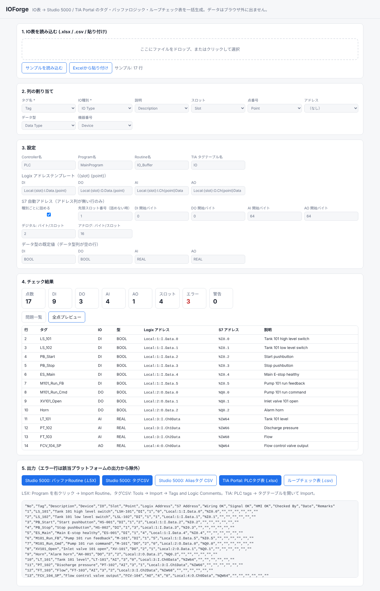

# IOForge

IO表（Excel/CSV）を読み込み、**検証してから** Studio 5000 と TIA Portal に取り込める形で一括出力するブラウザ完結ツール。

- Studio 5000: IOバッファ Routine (.L5X、DI→XIC/OTE, AI→MOV …)、タグ import CSV、Alias タグ CSV
- TIA Portal: PLCタグ表 (.xlsx、シート `PLC Tags`)
- 立上げ用ループチェック表 (.csv)
- 取込前チェック: Logix命名規則(英数字/_、40字、`__`禁止、末尾_禁止、予約語)、大小無視の重複、アドレス重複、DI/AI と %Q の取り違え、アナログ点の BOOL、S7 アドレス書式 (`%IX0.0` など IEC 風の誤記) …
- 列名は自動推定（Tag/Name/タグ名, IO Type/種別, Slot, Point/Ch …）し手動で変更可。データはサーバに送らない。

## 使い方
`index.html` をブラウザで開く（依存は `vendor/xlsx.full.min.js` のみ同梱、ネット不要）。「サンプルを読み込む」で動作確認できる。
テスト: `node tests/core.test.js`

## 状態（2026-11-18 夜間MVP）
- Web版。Chromium(Playwright)でサンプル読込→5種出力→xlsx再読込まで動作確認済み、コンソールエラーなし。
- **未検証**: 出力ファイルを実際の Studio 5000 / TIA Portal に取り込む確認はしていない（環境なし）。L5X は Studio 5000 v32 のエクスポート形式、タグCSVは `0.3` 形式、TIA の見出しは V15–V18 の export 見出しに合わせている。最初に実機で1回取り込んで差分を直すこと。

---

## 選定理由

### 狙った痛み
「新規案件のたびに、電気図面から起こしたIO表を見ながら、タグとIOバッファのラングを手で何百本も打つ／毎回Excelマクロを自作する」。表に出にくい（各社が社内マクロで凌いでいる）が案件ごとに必ず繰り返す作業。制御屋本人のドメインで、売り先の解像度も高い。

### データ（出典）
- 大手インテグレータ DMC が「IO表の Excel から VBA マクロで L5X のバッファRoutineを生成する」手順をブログ化：各点に1ラング必要で「hundreds of tags」の案件がある、IO変更時はシート修正→再生成で済む、という動機。 https://www.dmcinfo.com/blog/21783/generating-buffering-routines-on-an-allen-bradley-plc-using-excel-macros/
- 同種のナレッジ記事が量産されている＝検索需要がある：Studio 5000 への Excel タグ import の手順とエラー（Integer/DINT の誤記、重複、文字コード） https://industrialmonitordirect.com/blogs/knowledgebase/importing-excel-tags-into-rslogix-5000-studio-5000-csv 、TIA Portal の Excel タグ import エラー一覧（`%IX0.0` など IEC 書式で 0x80042A00、見出し言語不一致、末尾スペースで行が黙って落ちる 等） https://industrialmonitordirect.com/blogs/knowledgebase/resolving-tia-portal-excel-plc-tag-import-errors-v15-v18 、一括コード生成のテンプレ/マクロ https://industrialmonitordirect.com/blogs/knowledgebase/bulk-plc-code-generation-templates-macros-and-best-practices 、エイリアス付きIOリスト生成 https://industrialmonitordirect.com/blogs/knowledgebase/how-to-generate-io-listings-in-rslogix-5000-with-aliased-tags 、PlantPAx ACM 向け Excel→L5X 変換 https://industrialmonitordirect.com/blogs/knowledgebase/acm-io-import-excel-csv-to-plant-pax-l5x-conversion
  - ※ industrialmonitordirect は生成系の記事サイトで、記事の中身の正確性は低めに見ている。「同じ悩みの記事が多言語で大量に作られている＝検索される」という需要シグナルとして扱った。
- 既存解:
  - Rockwell ACM（Application Code Manager）: 無料だがPlantPAx/ライブラリ前提で重い。Siemens非対応。
  - PLCCodeTools（Miller Soft Systems）: CSV定義→L5X。Rockwellのみ、ドキュメント最終更新2020年。 https://millersoftsys.atlassian.net/wiki/spaces/PLCCODETOOLS/pages/404652049/PLCCodeTools+Introduction
  - tnunnink/ioList: 逆方向（L5X→IOリスト）、Windows WPF、22★、2026-06にアーカイブ。 https://github.com/tnunnink/ioList
  - 各社の自作VBA: 属人化、保守されない。
  - → **AB と Siemens の両方に、取込前の検証付きで、インストール無しで出せる**ものは見当たらない。

### 課金の根拠（推定）
- 対象はSI/装置メーカーの制御設計者。PLC開発ソフト自体が年数十万円（TIA Portal Professional 等）で、時間単価も高い。200点の案件でタグ＋バッファ打ちに半日〜1日 → 1案件で元が取れる価格帯なら通る。
- ただし「買う人が個人でなく会社」なので、購買の壁がある。まずは無料Web版で集客 → 有料はチーム機能/テンプレ保存/他メーカー出力。

## 却下した候補
| 候補 | 根拠データ | 却下理由 |
|---|---|---|
| Click PLC のプロジェクト差分ツール | Click/Click PLUS ソフトに比較機能が無く、印刷→テキスト差分で凌ぐ手順記事あり（AutomationDirect に要望登録済み） https://industrialmonitordirect.com/blogs/knowledgebase/click-plc-project-compare-workarounds-and-verification-workflow | `.cwp` 非公開形式・印刷出力サンプルが手元に無く一晩で正しいパーサが書けない。Click ユーザーは低価格志向で課金も弱い。将来候補として保留 |
| Claude Code 等のトークンコスト可視化 | Product Hunt に TokenWatch / Tokimeter / Halton Meter 等が連続ローンチ、「一晩で混雑カテゴリ化」との記事 https://enterprisedna.co/resources/ai-pulse/ai-pulse-2026-08-17-local-token-cost-trackers-become-a-crowded-category-overnigh/ | 既にレッドオーシャン、かつプラットフォーマーが公式機能で轢く典型 |
| 家のメンテナンス記録（selfhosted） | r/selfhosted の「欲しいツール」スレで複数人が要望（家電を登録すると点検タスクを自動提案） https://lr.in.psf.lt/r/selfhosted/comments/1jqc698/hot_take_whats_the_one_selfhosted_tool_this | LubeLogger/HomeZada/Homebox 等が既にあり差別化が薄い。selfhosted 層は課金しにくい |
| 子どもの解熱剤交互投与タイマー（育児） | 小児病院が交互投与の手順書を配布、専用アプリも出ている（Dosefully, OnCure） https://www.choa.org/-/media/Files/Childrens/teaching-sheets/how-to-alternate-acetaminophen-and-ibuprofen.pdf | 用量に関わる医療領域で責任リスクが大きい。既存アプリあり |

## ターゲット / 価格 / 集客
- ターゲット: 小〜中規模SI、装置メーカーの制御設計者（英語圏 AB/Siemens 現場、日本の Siemens 案件）。
- 価格案: 無料（〜100点、ウォーターマーク無し）／Pro 年$99/人（無制限、テンプレート保存、UDT・複数ラック、Ignition タグJSON 出力）／Team 年$399（共有テンプレ）。
- 集客: r/PLC・PLCtalk で「Excel マクロ置き換え」として無料版を紹介、上記の import エラー系検索キーワードで解説ページ（SEO）、LinkedIn の制御屋コミュニティ。

## MVP の範囲（今夜）
- CSV/TSV/XLSX 読込、Excel 貼り付け、列自動推定・手動マッピング
- 検証（Logix/TIA 別ターゲットで判定、エラー行は該当出力から除外）
- 出力5種（L5X Routine、Logix タグCSV、Alias CSV、TIA xlsx、ループチェック表）
- Logix アドレステンプレート（`Local:{slot}:I.Data.{point}` など、リモートラックは `RackA:{slot}:I.Data.{point}` に変えれば対応）
- S7 自動アドレス（種別ごとに詰める／スロット位置そのまま）

## 次にやるべきこと
1. **実機取込テスト**（最優先）: Studio 5000 v3x で L5X/CSV、TIA V17/V18/V19 で xlsx。見出し言語（独/日）対応が必要か確認。
2. Studio 5000 の CSV ヘッダは `remark` 行のバージョン依存があるので、ユーザーが自分の export を1つ貼ると形式を合わせるモードを付ける。
3. アナログのスケーリング（SCP / NORM_X+SCALE_X）ラング生成、TIA の SCL バッファ FC 出力。
4. Ignition / FactoryTalk View のタグ出力、三菱 GX Works3 グローバルラベル CSV。
5. 実際の r/PLC 投稿・PLCtalk スレで反応を見る（Reddit本体は今夜の調査ではプロキシに阻まれ直接読めていない）。
